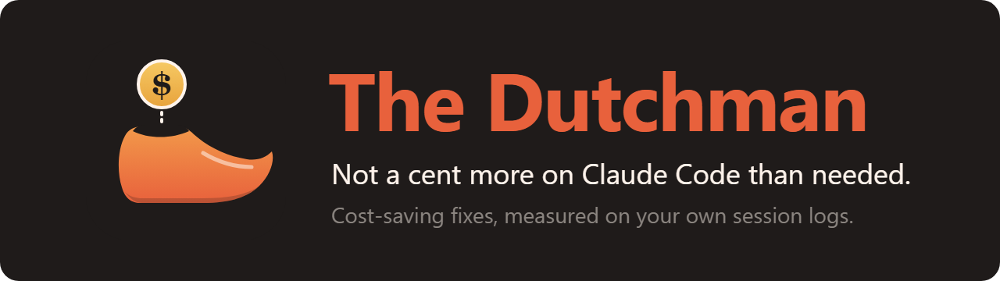

<p align="center">
  
</p>

As we all know, the Dutch are notoriously stingy. And yet we could all use a Dutchman looking over our shoulder
while we use Claude.

The Dutchman reads your own Claude Code logs, finds the settings and habits that cost you money, and tells you how
much. One click applies the fix, and one click undoes it.

[](https://github.com/daanmeersseman/the-dutchman/actions/workflows/ci.yml)
[](LICENSE)


```
/plugin marketplace add daanmeersseman/the-dutchman
/plugin install dutchman@the-dutchman
```

## Why

Much of a Claude Code bill goes to what surrounds the work: the context sent again on every turn, a cache that
expired while you read, a subagent on the most expensive model, a session that kept growing. Each of these is a
setting or a habit, and each one is easy to fix once you can see it.

The Dutchman shows which ones apply to *you*, priced on your own sessions.

## What it looks like

```
╭─ The Dutchman ─────────────────────────────────────────────────────────────╮
│ $864 in 30 days  ·  ~$57/mo to save  ·  $145/mo at stake           Refresh │
│ Amounts are at list price and count only logged calls; your bill can       │
│ differ by a few percent.                                                   │
│                                                                            │
│ [ Open 6 ]  Applied & dismissed 0   Settings                               │
│                                                                            │
│ FIXES                                                                      │
│ ▾ Let Opus plan and Sonnet do the work                             ~$57/mo │
│     Why      Your sessions ran on Opus for planning and doing alike:       │
│              $520 of $590, not counting subagents.                         │
│     How      With "opusplan", Opus writes the plan; after you approve      │
│              it, Sonnet carries it out at about half the price.            │
│     Saving   About $57 per month at list price.                            │
│     Changes  Sets "model": "opusplan" in ~/.claude/settings.json           │
│              (now "sonnet"). Every file is backed up first.                │
│                                                                            │
│     [ Apply ]  [ Show the change ]  [ Dismiss ]                            │
│                                                                            │
│ ▸ Turn off the MCP server you never use here: aspire                       │
│                                                                            │
│ REMINDERS                                                                  │
│ ▸ Get a nudge when a session passes 250k tokens                     $91/mo │
│ ▸ Get a nudge when you resume a big session                         $28/mo │
│                                                                            │
│ CHECKS                                                                     │
│ ▸ Your subagent model setting is not applied                        $23/mo │
│ ▸ 3 rules in this repo load on every turn                            $3/mo │
╰────────────────────────────────────────────────────────────────────────────╯
```

A `~` amount is what the fix saves. An amount without `~` is what the problem cost you; the reminder or check helps
you act on it. **Show the change** lists what Apply changes, before anything is written:

```
~/.claude/settings.json
  model: "sonnet" → "opusplan"
```

## How it works

1. **At session start**, The Dutchman reads your settings and your logs in `~/.claude/projects`, in the background.
   By default it reads the last 30 days, at most once a day.
2. **By default a pane opens** with the tips that apply to you, grouped as fixes, reminders and checks.
3. **Open a tip** to see what was found in your logs, how the fix works and what the amount assumes.
4. **Apply** (or **Turn on** for a reminder) makes the change without calling a model. Every file is backed up first.
   The tip moves to **Applied & dismissed**, where **Undo** puts the file back. If a settings file changed since, Undo
   puts back only what this tip changed, and refuses when you changed that same setting yourself.

## The tips

A tip shows only when your own logs show the problem, and only after 7 days of logs. Amounts are per month: with
fewer than 30 days of logs, they are scaled up from the days there are.

**Fixes** change a setting or a file. One click, one click back.

| Tip | What Apply does | Amount |
|---|---|---|
| **1-hour cache** | Keeps the prompt cache warm for an hour instead of 5 minutes | exact |
| **Opus plans, Sonnet works** | Sets the main model to `opusplan`, and starts sessions in plan mode unless you chose a mode | estimate |
| **Subagents on Sonnet** | Runs the built-in Explore, Plan and general-purpose agents on Sonnet | estimate |
| **Lower effort** | Sets Opus to medium effort when it runs at xhigh or max for everything | estimate |
| **Ignored effort setting** | Moves an effort setting to where Opus reads it | setting |
| **Concise output** | Sets the Concise output style when none is set | estimate |
| **Output style spelling** | Fixes an output style that is not active because of its spelling | setting |
| **Auto-compact window** | Replaces a low auto-compact percentage with a fixed window of 300k tokens | setting |
| **Browser agent** | Adds a Sonnet subagent for Playwright, so screenshots stay out of the main session | estimate |
| **CLAUDE.md imports** | Turns an `@file` import in your user CLAUDE.md into a line Claude reads only when needed | measured |
| **Unused MCP servers** | Turns off MCP servers you never call, in this project or in your user config | count |
| **Unused plugins** | Disables plugins whose skills, commands and agents you never use | count |
| **Idle skills** | Makes skills Claude never picks load only when you type `/name` | count |

**Reminders** are notices at the moment a habit starts to cost money.

| Tip | When it nudges you | Amount |
|---|---|---|
| **Long sessions** | A session passes 250k tokens. Also installs a `/handover` skill to start fresh. | measured |
| **Cache expiry** | A big session is about to lose its cache while you are away | measured |
| **Cold resume** | You resume a big session whose cache has expired | measured |

**Checks** point out what The Dutchman cannot change for you, and say what to do.

| Tip | What it points out | Amount |
|---|---|---|
| **Always-on rules** | Project rules without a path scope, loaded on every turn | measured |
| **Command output** | Shell output that fills your context; suggests RTK | count |
| **Subagent model not applied** | `CLAUDE_CODE_SUBAGENT_MODEL` is set, yet subagents still ran on Opus | measured |

*Exact* replays your own calls with the change. *Estimate* rests on one assumption, shown with the tip. *Measured* is
what the problem cost you, without promising what a fix saves. *Setting* and *count* carry no amount: the tip names a
setting that is wrong, or counts what goes unused.

## Settings

On first start the pane asks four things, with the recommended answer picked. Press **Save** to keep them.

| Question | Options | Recommended |
|---|---|---|
| Show tips from | $1, $5, $20 per month, or any | **$5** |
| At session start | open the pane, show a notice, or do nothing until you type `/dutchman` | **open the pane** |
| Show them at most | every session, daily, weekly, monthly | **weekly** |
| Nudge when a session passes | 150k, 250k, 400k tokens, or off | **250k** |

The **Settings** tab holds these too, plus how many days of logs to read (14, 30 or 90), how often to read them again
(daily, weekly, or only on Refresh) and from what monthly cost the cache reminders are offered ($5, $20 or off).

| Command | |
|---|---|
| `/dutchman` | Open the pane |
| `/dutchman refresh` | Read the logs again, then open the pane |
| `/dutchman setup` | Show the first-start questions again |

## Privacy

The Dutchman runs on your machine. It reads local files only, sends nothing anywhere, and never calls a model.

Amounts are at Anthropic list price, so they hold for an API key. On a subscription, read them as how much of your
usage limit a habit takes. Backups of every file Apply changes live in `~/.claude/dutchman/backups/`.

## Requirements

- Claude Code 2.1.275 or later
- Python 3 on the `PATH` as `python` or `python3`

## The guide

[The cost guide](docs/guide.md) behind these tips explains how Claude Code is billed, what the cache does, which
model fits which work, and how to keep sessions small.

## Contributing

A new tip is one Python file. [CONTRIBUTING.md](CONTRIBUTING.md) has the layout, the tip format and how to test.
An idea without the code is welcome too: open a
[tip idea](https://github.com/daanmeersseman/the-dutchman/issues/new?template=tip-idea.md).

## Credits

Made by [@daanmeersseman](https://github.com/daanmeersseman). Works side by side with
[Frugalitas](https://github.com/siposzoltan03/frugalitas), which shows spend live when Claude Code runs through a
LiteLLM proxy. The Dutchman leaves the status line to Frugalitas, and its reminders defer to Frugalitas when both are
installed.

## License

[MIT](LICENSE)
